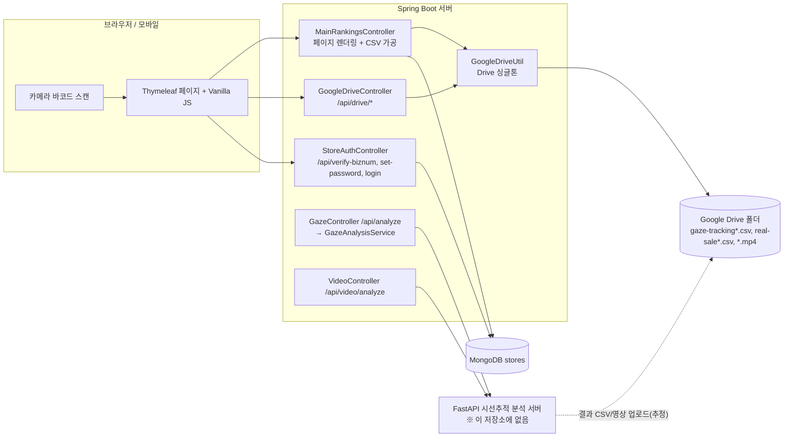

# PORTFOLIO_ANALYSIS — 시선추적 기반 관심도 분석 & 마케팅 웹 (gaze_tracking_interest)

- 분석 대상: `C:\dev\gaze_tracking_interest-main\gaze_tracking_interest` (git 저장소, 커밋 67개, 2025-03-30 ~ 2025-11-26)
- 분석 방식: 코드·git 기록 읽기 전용(소스 수정 없음). 라인 근거는 현재 HEAD(`bfce00e`) 기준.
- 주의: 이 폴더 바깥 `gaze_tracking_interest-main/`에도 pom.xml, src 등이 한 벌 더 있고 일부 파일이 서로 다릅니다(§9 질문 1).

---

## 🚨 공개 전 반드시 처리 (최우선)

| # | 항목 | 근거 | 조치 |
|---|---|---|---|
| 1 | **MongoDB Atlas 접속 URI(계정·비밀번호 포함)가 git에 추적되는 `application.properties`에 평문으로 있음** | `src/main/resources/application.properties:11` (`git ls-files`에 포함, 파일 이력 커밋 `84be179`, `c3a9fbd`, `ea3c9a7`) | **비밀번호 즉시 교체(rotate)** → 환경변수(`${MONGODB_URI}`)로 분리 → 이력에 남아 있으므로 교체가 핵심(파일만 고쳐서는 부족) |
| 2 | **Google Drive `credentials.json`/토큰이 과거 커밋에 올라갔다가 삭제됨** | 추가 커밋 `ea3c9a7`, `84be179`; 삭제 커밋 `eaa74a5`, `177c63f`, `e4a3f33`, `23804b7`, `d4af560` (삭제는 이력에서 지워지지 않음) | 해당 키/OAuth 클라이언트 **폐기 후 재발급**, 공개 저장소로 올릴 거면 `git filter-repo`/BFG로 이력 정리 또는 새 저장소로 이전 |
| 3 | Google Drive 폴더 ID, 개인 Drive 연동 하드코딩 | `GoogleDriveController.java:19`, `MainRankingsController.java:49,190`, `DriveTest.java:16` | 설정값(`@Value`)으로 분리 |
| 4 | 배포 서버 주소·임시 ngrok/Colab 주소 흔적 | `VideoController.java:17`(`gaze-fastapi.onrender.com`), 커밋 `5199d97 임시 구글 colab ngrok 주소` | 공개 전 주소·설정 정리 |
| 5 | 사업자번호(개인정보 성격) 조회/노출 | `MainRankingsController.java:159,172,185,220,233`(템플릿 모델에 `businessNumber` 전달), `StoreAuthController.java:26-41` | 실데이터 아닌지 확인, 화면·API로 노출하지 않기 |

> `application.properties`의 값은 이 문서에 옮기지 않았습니다(키 이름만 확인).

---

## 1. 프로젝트 한 줄 요약 + 3줄 소개

**한 줄**: 시선추적(gaze tracking) 분석 결과 CSV를 Google Drive에서 읽어 상품별 주목도 순위·시간대 비교·구매 전환율을 보여주고, 점주 인증/바코드 프로모션까지 제공하는 Spring Boot 웹 서비스.

1. 매장 영상에서 AI가 계산한 상품별 시선 수(CSV)를 **Google Drive API**로 가져와 **Thymeleaf**로 순위 화면(카테고리·가격 필터)을 렌더링합니다.
2. 점주는 사업자번호 인증 → 비밀번호 설정(**BCrypt**) → 로그인 후 대시보드에서 분석 영상 목록, 날짜·시간대 비교, 시선 수 대비 판매 수 **구매 전환율** 표를 봅니다.
3. 손님은 카메라로 상품 바코드를 스캔(**html5-qrcode**)해 상품별 프로모션 페이지로 이동합니다.

개발 기간(README): 2025.04~, 팀 프로젝트. 담당(README): 웹 개발 전반(프론트+백엔드).

## 2. 기술 스택

| 영역 | 기술 | 근거 |
|---|---|---|
| 언어/런타임 | Java 17 | `pom.xml` `java.version` |
| 프레임워크 | Spring Boot 3.4.4 (Web, Thymeleaf, Security, Data MongoDB, WebFlux) | `pom.xml` |
| DB | MongoDB (Atlas로 보이는 원격) — `stores` 컬렉션 | `Store.java:12`, `application.properties:10-12` |
| 외부 연동 | Google Drive API v3 (`google-api-services-drive`), Google OAuth, 외부 FastAPI 분석 서버 | `GoogleDriveUtil.java`, `VideoController.java:17`, `GazeAnalysisService.java:15` |
| 보안 | Spring Security + BCryptPasswordEncoder | `PasswordEncoderConfig.java:12`, `StoreAuthController.java:50,63` |
| 프론트 | Vanilla JS, Thymeleaf 템플릿, CSS, PapaParse(CSV 파싱), html5-qrcode | `static/js/*`, `templates/*` (PapaParse 사용: `dashboard_comparison.js:~150`) |
| 인프라 | Docker 멀티스테이지 빌드, Render 배포 | `Dockerfile`, 커밋 `41c428d`, `a96e368`, `c7cab26` |
| 테스트 | `contextLoads` 1개뿐 | `GazeTrackingInterestApplicationTests.java` |

## 3. 아키텍처

데이터 흐름(코드로 확인된 부분): 영상 → (외부 FastAPI 분석, 코드 없음) → Drive에 `gaze-tracking*.csv` → `MainRankingsController.rankings()`가 최신 CSV 선택·파싱 → 모델에 `csvData`, `categories` 전달 → `main_rankings.html` 렌더링. 비교 대시보드는 브라우저가 `/api/drive/csv-list`, `/api/drive/file?name=`을 호출해 CSV를 받아 JS에서 병합합니다.
※ "FastAPI가 Drive에 결과를 올린다"는 부분은 이 저장소에서 확인되지 않음(추정, §9 질문 3).

## 4. 나의 기여

### 4-1. git 근거로 확인되는 것
- `git shortlog`: 작성자가 `Eunseo-ee <2whwhwh@gmail.com>` 59건 + `Eunseo-ee <…@users.noreply.github.com>` 8건 = **67건 전부** 동일 인물(이 저장소 기준).
- `git blame` 결과 `src/main` 아래 Java·JS·HTML·CSS **전 파일 전 라인이 Eunseo-ee** 한 명.

### 4-2. 해석 (중요)
이 저장소에는 팀원 커밋이 **없습니다**. 따라서 "내가 만든 것 vs 팀원 것"을 git만으로는 **구분할 수 없습니다**. 가능한 설명은 (a) 웹(Spring) 파트를 본인이 전담했고 AI/시선추적(FastAPI, Colab)은 별도 저장소에 있다, (b) 팀원 코드를 본인이 복사해 커밋했다 — 둘 중 어느 쪽인지는 **확인 불가**입니다(§9).

### 4-3. 이 저장소에서 본인 이름으로 확인되는 구현 (파일 단위)

| 기능 | 파일 | 규모/근거 |
|---|---|---|
| 점주 인증·비밀번호 설정·로그인 API | `controller/StoreAuthController.java:26-67`, `entity/Store.java`, `repository/StoreRepository.java`, `config/PasswordEncoderConfig.java`, `static/js/owner_verification.js`(108줄), `templates/owner.html`(225줄) | 커밋 `2be7142`, `3e4af5a`, `1c6afd0` |
| Google Drive 연동(인증 3단계 폴백, 목록/다운로드) | `config/GoogleDriveUtil.java:31-180`, `controller/GoogleDriveController.java` | 커밋 `ea3c9a7`~`f908ce7`(2025-10-30~31), `c7cab26` 등 배포 이슈 수정 6건 |
| 랭킹 페이지(최신 CSV 선택, 파싱, 카테고리 집계, 필터) | `controller/MainRankingsController.java:41-148`, `templates/main_rankings.html`, `static/css/rankings.css` | 커밋 `885aae0 rankings category, price filtering`, `3ac1553` |
| 점주 대시보드(영상 목록, 업로드 UI, 비교 탭) | `MainRankingsController.java:151-237`, `static/js/dashboard_*.js`(video 59 / upload 44 / comparison 315줄), `templates/dashboard*.html` | 커밋 `1447839`, `2aa7d62`, `84be179` |
| 시선 수 vs 판매 수 구매 전환율 표 | `static/js/dashboard_comparison.js` (`loadConversionTable`, 병합 로직 약 108-140행대) | 커밋 `1447839`(dashboard_comparison 탭) |
| 바코드 스캔 → 프로모션 페이지 | `static/js/promotion_barcodeScanner.js:1-43`, `controller/PromotionController.java`, `templates/promotion*.html`(7개) | 커밋 `909a4a8`, `7743ba6` |
| 외부 분석 서버 호출(FastAPI) | `controller/VideoController.java:15-22`, `controller/GazeController.java`, `service/GazeAnalysisService.java:17-28` | 사용 여부는 §8 참고 |
| 배포(Docker/Render, 업로드 자동 복사) | `Dockerfile`, `prepare_uploads.sh`, 커밋 `41c428d`, `6141ae2`, `f88c1b7` | |

### 4-4. 팀 공동 작업
**확인 불가** (git에 팀원 흔적 없음). 시선추적 AI 모델/FastAPI 서버, 영상 촬영·데이터 수집은 이 저장소에 코드가 없어 "별도 담당"으로만 추정됩니다.

## 5. 기술적 하이라이트

1. **Google Drive 인증 3단계 폴백 + 이중 확인 잠금 싱글톤** — `GoogleDriveUtil.java:54-62`(double-checked locking, `volatile` `DRIVE`), `:66-142`(Render secret 경로 → 서비스 계정 → 로컬 OAuth 순으로 선택). 로컬/배포 환경 차이를 코드 한 곳에서 흡수. 배포 시 Drive 접근이 안 되던 문제를 커밋 `c7cab26` 등 6회 수정하며 해결한 이력이 있어 "디버깅 경험"으로 쓸 수 있음.
2. **외부 데이터(CSV)를 서버에서 정제해 서버사이드 렌더링** — `MainRankingsController.java:56-76`(파일명 접두사 `gaze-tracking`·`.csv` 필터 후 `modifiedTime` 최대값으로 최신 선택), `:87-133`(인덱스 `-` 행 제외, 가격에서 숫자 외 문자 제거, 컬럼 보정, 카테고리 `TreeSet` 수집으로 필터 옵션 자동 생성). DB 없이 파일 기반 결과를 화면까지 연결한 파이프라인.
3. **점주 인증 흐름** — `StoreAuthController.java:26-41`(사업자번호 확인) → `:45-56`(BCrypt 해시 저장, `isVerified` 설정) → `:59-67`(`matches`로 검증). 평문 비밀번호를 저장하지 않는 설계. (한계는 §7 참조)
4. **시선·판매 데이터 결합(구매 전환율)** — `dashboard_comparison.js`: 날짜·시간대 조건으로 파일명 후보를 만들고(`buildTimeKeys`, 6가지 표기 변형), 시간 미선택 시 전일 데이터를 상품 단위로 집계(`aggregateGazeByProduct`), 시선 수와 판매 수를 상품명으로 병합해 전환율 계산. 파일명 규칙이 일정하지 않은 데이터를 다루려는 방어적 처리.
5. **배포 환경 대응** — `Dockerfile` 멀티스테이지 빌드(Maven 빌드 → JRE 17 런타임), `prepare_uploads.sh`/exec-maven-plugin으로 정적 업로드 파일 자동 복사(커밋 `f88c1b7`), 대용량 파일 추적 제거(`d403277`, `181cc9d`).

## 6. 포트폴리오용 문장

수치가 필요한 곳은 `[수치 입력 필요]`로 비워 두었습니다. **"본인 담당"으로 쓰기 전에 §9 질문 2 확인 필요.**

- 매장 영상의 시선추적 결과(CSV)를 **Google Drive API v3**로 조회·다운로드해 **최신 파일 자동 선택 → 서버 정제 → Thymeleaf 렌더링**하는 주목도 순위 페이지를 구현, 카테고리·가격 필터를 데이터에서 자동 생성.
- 로컬 OAuth / Render Secret / 서비스 계정을 **환경에 따라 폴백**하는 Drive 클라이언트를 **double-checked locking 싱글톤**으로 구성해, 배포 환경 Drive 접근 오류를 해결 (관련 수정 커밋 6건).
- 사업자번호 확인 → **BCrypt 해시** 비밀번호 설정 → 로그인으로 이어지는 점주 인증 API(MongoDB `stores`)를 구현.
- 날짜·시간대·카테고리 조건으로 시선 수와 판매 수 CSV를 병합해 **구매 전환율 비교 대시보드** 구현(상품별 집계, 파일명 표기 변형 대응).
- 카메라 기반 **바코드 스캔 → 상품별 프로모션 페이지 라우팅** 구현(모바일 viewport 대응 포함).
- **Docker 멀티스테이지 + Render** 배포 구성, 대용량 파일은 이력/추적에서 제외해 저장소 크기 관리. 서비스 사용자/처리량: `[수치 입력 필요]`.
- 시선추적 데이터 처리 시간 개선/정확도: `[수치 입력 필요]` (코드에서 측정 근거 없음 — 지어내지 말 것).

**STAR (Drive 배포 오류 해결)**
- **S**: 로컬에서는 동작하던 Google Drive 연동이 Render 배포 후 접근 불가(커밋 `571101a`~`c7cab26`, 2025-07-30).
- **T**: 로컬·배포 두 환경에서 같은 코드로 Drive 인증이 되게 만들기.
- **A**: 인증 경로를 Render secret → 서비스 계정 → 로컬 OAuth 순서로 탐색하는 구조로 `GoogleDriveUtil`을 재작성하고, 클라이언트를 싱글톤으로 재사용. 이후 `credentials.json` 등 비밀 파일을 `.gitignore`/추적 제거(`177c63f`, `37908b2`, `d4af560`).
- **R**: 배포 환경에서 CSV·영상 목록 조회 동작(최종 화면 연동 커밋 `63e13bb`, `f908ce7`). 정량 결과: `[수치 입력 필요]`. (비밀 파일을 한 번 커밋한 점은 반성/개선점으로 함께 말하는 편이 정직함)

## 7. 예상 면접 질문 10개 + 답변 포인트

1. **프로젝트에서 본인 역할은? 팀 분업은?** — README "웹 개발 전반". 이 저장소 커밋 67건이 모두 본인이라는 사실은 근거가 되지만, AI 파트와의 경계는 §9 질문으로 정리 후 답변.
2. **DB로 MongoDB를 쓴 이유?** — `Store` 문서(`Store.java:12-31`)가 단순 키-값 성격. 다만 "왜 RDB가 아닌가"는 코드에 근거가 없으니 실제 이유를 직접 정리할 것. 현재 DB 사용은 `stores` 한 컬렉션뿐.
3. **CSV를 DB에 넣지 않고 Drive에서 직접 읽은 이유와 한계는?** — `MainRankingsController.java:49,83`. 장점: AI 서버가 파일만 올리면 연동. 한계: 요청마다 Drive 목록 조회·다운로드(캐시 없음), 파일명 규칙 의존, 파싱이 `split(",")`(`:96`)라 따옴표 포함 CSV 취약. 개선: 캐시 또는 주기 적재.
4. **Drive 클라이언트를 싱글톤으로 만든 이유? `volatile`은 왜?** — `GoogleDriveUtil.java:52-62`. 인증 객체 생성 비용 절감, 이중 확인 잠금에서 부분 초기화된 객체 노출 방지.
5. **비밀번호를 어떻게 저장·검증하나? 한계는?** — BCrypt(`StoreAuthController.java:50,63`). 한계: 로그인 성공 시 세션/토큰 발급이 없고(`:64` 문자열만 반환), 대시보드 URL이 인증 없이 열림(`SecurityConfig.java:22-23` `anyRequest().permitAll()`), 사업자번호 확인 API는 누구나 호출·무차별 대입 가능, CSRF 비활성화(`:18`).
6. **Spring Security를 쓰는데 왜 전부 permitAll인가?** — 솔직히 BCrypt 인코더 목적이 큼. 개선안: 세션/JWT + `/store/*/owner_dashboard` 보호, 로그인 시도 제한.
7. **배포 중 겪은 문제와 해결은?** — STAR(§6). 커밋 6건의 반복 수정과 `.gitignore` 정리, 비밀 파일 노출 후 조치 경험.
8. **CORS를 `*`로 연 이유?** — `WebConfig.java:13`, `GazeController.java:11`. 개발 편의. 운영에서는 출처 제한 필요(§8).
9. **예외 처리는 어떻게 했나?** — `GoogleDriveController`는 `catch (Exception)` 후 500 + 메시지 반환(`:45-48`), 스택트레이스 `printStackTrace()`. 개선: `@ControllerAdvice`, 구체 예외, 로깅 프레임워크, 내부 메시지 비노출.
10. **구매 전환율은 어떻게 계산했고 한계는?** — `dashboard_comparison.js`: 판매수/시선수×100, 상품명 문자열로 병합. 한계: 상품명이 키(바코드 아님), 시선 수 0이면 0% 처리, 프론트에서 대량 CSV 병합 → 데이터 커지면 서버 이전 고려. (CSV에 `상품바코드` 컬럼이 있음 — `static/uploads/test_rankings.csv` 헤더)

## 8. 코드 품질 점검 및 개선 아이디어

### 8-1. 점검 (내 담당 위주)

| 우선순위 | 항목 | 근거 |
|---|---|---|
| 상 | DB 비밀번호 평문 커밋 + 이력 잔존 (§위 🚨1) | `application.properties:11` |
| 상 | Drive 자격증명 과거 커밋 노출 (🚨2) | `ea3c9a7`, `84be179` |
| 상 | 점주 페이지/API에 서버측 인증·인가 없음 (URL 직접 접근 가능, 로그인 성공 후 상태 저장 없음) | `SecurityConfig.java:21-24`, `StoreAuthController.java:59-67` |
| 상 | 사업자번호 평문 비교·무차별 대입 방어 없음 | `StoreAuthController.java:31-36` |
| 상 | XSS 가능성: CSV 값을 `innerHTML +=`로 삽입 | `dashboard_comparison.js` `renderConversionTable` (`tbody.innerHTML += ...`) |
| 중 | 매장 코드 `B06` 하드코딩 14곳, 단일 매장만 지원 | `MainRankingsController.java:34-237`, `PromotionController.java:9,12` |
| 중 | 요청마다 Drive 목록 조회, 캐시 없음; `/api/drive/file`이 파일 하나 읽으려 폴더 전체 조회 | `GoogleDriveController.java:113-124` |
| 중 | 폴더 조회가 페이지네이션 없이 한 번만(`files().list()` 기본 크기) → 파일 많으면 누락 | `GoogleDriveUtil.java:162-165` |
| 중 | CSV 파싱을 `split(",")`로 처리 | `MainRankingsController.java:96` |
| 중 | 예외 처리 `printStackTrace` + 예외 메시지 클라이언트 노출 | `GoogleDriveController.java:46-47` 등 |
| 중 | 분석 서버 주소 불일치/하드코딩: `localhost:8000` vs `onrender.com` vs `application.properties`의 `fastapi.server.url` 미사용 | `GazeAnalysisService.java:15`, `VideoController.java:17` |
| 중 | `VideoController`가 `@RestController`인데 `Model`/뷰 이름 `"analyze"` 반환(의도대로 동작 안 함), 해당 템플릿 없음 | `VideoController.java:9,16,22` |
| 중 | CORS `*`, CSRF 비활성화 | `WebConfig.java:13`, `SecurityConfig.java:18` |
| 하 | 사용되지 않는 코드: `GoogleSecretsFactory`, `DriveTest`(main 소스에 테스트 클래스), `isFirstLine` 변수 미사용 | `GoogleSecretsFactory.java`, `DriveTest.java`, `MainRankingsController.java:89,131` |
| 하 | 중복: 대시보드 5개 메서드가 동일 코드, `promotion_detail1~6` 컨트롤러·템플릿 복제 | `MainRankingsController.java:151-237`, `PromotionController.java:14-54` |
| 하 | 바코드→경로 매핑이 JS에 하드코딩 | `promotion_barcodeScanner.js:1-8` |
| 하 | 테스트가 `contextLoads` 1개(실제 Mongo/Drive 설정 없으면 실패 가능) | `GazeTrackingInterestApplicationTests.java` |
| 하 | `PasswordEncoderConfig`와 `SecurityConfig`에서 `BCryptPasswordEncoder` import 중복, `isVerified` Lombok 게터 이름 혼동 가능 | `SecurityConfig.java:7-8`, `Store.java:31` |

> 어떤 테스트도 실행하지 않았습니다(분석 전용). 위 버그 가능성은 코드 읽기 기준이며 실제 동작은 미검증입니다.

### 8-2. 포트폴리오 가치를 높이는 개선 아이디어

| # | 아이디어 | 난이도 | 효과 |
|---|---|---|---|
| 1 | 시크릿 분리(환경변수) + 이력 정리 + README에 실행법 | 하 | **상** (공개 필수, 보안 인식 증명) |
| 2 | CSV 서비스 계층 분리(`CsvRankingService`) + 단위 테스트(파싱, 최신 파일 선택, 가격 정제) | 중 | 상 (테스트·구조 개선 스토리) |
| 3 | 로그인 후 세션/JWT + `/owner*`·`/dashboard*` 보호, 시도 횟수 제한 | 중 | 상 |
| 4 | Drive 응답 캐시(예: Caffeine, TTL) + 목록 페이지네이션, 전/후 응답시간 측정 | 중 | 상 (수치 확보 가능: 측정 후 기록) |
| 5 | `storeCode` 경로 변수화 + 매장 다중 지원, 프로모션 바코드 DB화 | 중 | 중 |

## 9. 확인 불가 항목 및 나에게 물어볼 질문

1. `gaze_tracking_interest-main/`(바깥)과 `gaze_tracking_interest-main/gaze_tracking_interest/`(git 저장소) 중 **어느 쪽이 최종본**인가요? 바깥 폴더에도 `pom.xml`, `Dockerfile`, `DriveTest.java` 등이 있고 내용이 서로 다릅니다(`diff -rq`로 확인).
2. 이 저장소 커밋이 전부 본인인데, 팀원은 몇 명이고 각자 무엇을 했나요? 팀원 작업(AI 모델, FastAPI, 영상 촬영 등)은 **다른 저장소**에 있나요? 있다면 그 저장소도 분석해야 정확한 기여 구분이 가능합니다.
3. 시선추적 분석 결과 CSV(`gaze-tracking_*.csv`)와 판매 CSV(`real-sale_*.csv`)는 **누가 어떤 방식으로 Drive에 올렸나요**(Colab/FastAPI 자동 업로드인지)? README의 "1시간 주기 자동 업로드" 근거 코드는 이 저장소에서 못 찾았습니다.
4. `GazeController`(`/api/analyze`)와 `VideoController`(`/api/video/analyze`)는 **실제로 화면에서 쓰였나요**? 프런트 JS에서 호출하는 곳을 찾지 못했습니다.
5. 프로젝트의 **정량 결과**(정확도, 사용자 수, 시연 매장/기간, 처리 시간 등)가 있나요? 있으면 §6의 `[수치 입력 필요]`를 채울 수 있습니다.
6. MongoDB 비밀번호와 Google 자격증명은 **이미 교체**했나요? (🚨1, 2)
7. `promotion_detail1~6`의 상품·바코드 숫자는 실제 매장 데이터인가요, 데모 데이터인가요?
8. 사업자번호(`stores` 컬렉션)는 실제 번호인가요, 가짜 데이터인가요?
9. Git 이름/이메일은 `Eunseo-ee`로 보이는데, 이력서에 쓸 이름과 같은가요? (요청서의 `[여기에 입력]` 항목이 비어 있어 git 기록으로 대체했습니다)
10. 전기정보공학과 졸업작품으로서 **하드웨어/센서 쪽 담당**이 있었나요? 그 부분이 본인 담당이라면 이 저장소에는 근거가 없어 별도 자료가 필요합니다.
