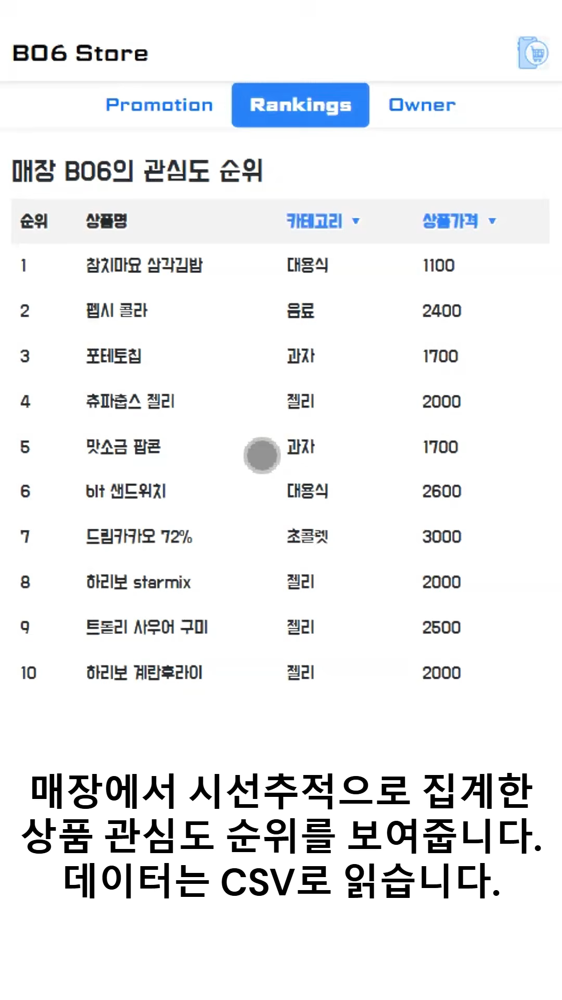
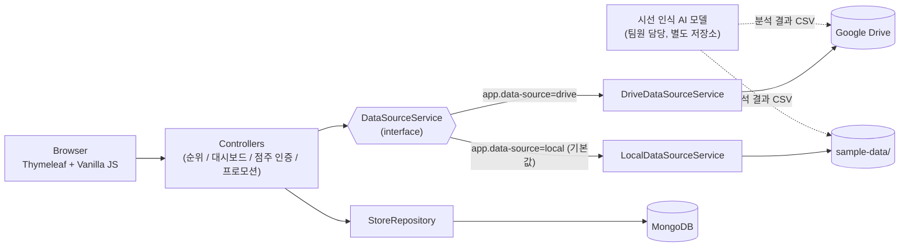

# 시선추적 기반 상품 관심도 분석 웹

매장 영상의 시선추적 결과(CSV)를 읽어 상품별 주목도 순위, 시간대 비교, 구매 전환율을 보여주는 Spring Boot 웹 서비스입니다.

## 데모

[▶ 데모 영상 보기](<영상링크>) (YouTube, 일부 공개)

<!-- 스크린샷 파일을 docs/images/ 에 추가한 뒤 아래 주석을 해제하세요.
| 순위 화면 | 대시보드 |
|---|---|
|  |  |
| **시간대/전환율 비교** | **바코드 프로모션** |
|  |  |
-->

## 프로젝트 소개

편의점 같은 소매 매장에서는 어떤 상품이 손님의 눈길을 끄는지, 그 관심이 실제 구매로 이어지는지 알기 어렵습니다.
이 프로젝트는 매장 영상에서 추출한 시선추적 결과와 판매 데이터를 한 화면에서 비교해 점주가 진열·프로모션 판단에 참고할 수 있게 하는 것을 목표로 했습니다.
시선 분석은 AI 모델이 담당하고, 이 저장소의 웹은 그 결과 CSV를 읽어 시각화하는 부분입니다.
졸업 프로젝트로 진행했으며 2025.04부터 개발했습니다.

## 팀과 내 역할

팀 2명 프로젝트입니다.

| 구분 | 내용 |
|---|---|
| 내가 담당 | 웹 서비스 전체 (프론트엔드 + 백엔드): 순위·대시보드 화면, 점주 인증, 비교/전환율 화면, 바코드 프로모션, 데이터 소스 추상화, 배포 설정 |
| 팀원 담당 | 시선 인식 AI 모델 (별도 저장소, 이 저장소에 코드 없음) |
| 맞닿는 지점 | AI 쪽이 만든 시선추적 결과 CSV(`gaze-tracking_<날짜>_<시작시>-<종료시>.csv`)를 웹이 읽어 표시 |

## 주요 기능

- **순위 화면**: 가장 최근 시선추적 CSV를 읽어 상품별 주목도 순위를 표로 보여주며, 카테고리와 가격 범위로 필터링합니다.
- **점주 인증**: 사업자번호 확인 후 비밀번호를 설정하고, 비밀번호는 BCrypt로 해시해 MongoDB에 저장합니다.
- **대시보드**: 영상 목록 재생, 날짜·시간대·카테고리별 시선 순위와 판매 순위 비교.
- **구매 전환율**: 상품별 판매 수량을 시선추적 수로 나눠 전환율을 계산합니다.
- **바코드 프로모션**: 브라우저 카메라로 바코드를 인식해 해당 상품의 프로모션 페이지로 이동합니다. 카메라가 필요해 데모 영상에는 포함하지 않았습니다.

## 기술 스택

| 영역 | 사용 기술 |
|---|---|
| Backend | Java 17, Spring Boot 3.4.4, Spring Web, Spring Security(`BCryptPasswordEncoder`), Spring WebFlux(`WebClient`), Lombok |
| View | Thymeleaf, Vanilla JavaScript, Bootstrap 5, PapaParse(CSV 파싱), html5-qrcode(바코드 스캔) |
| Database | MongoDB (Spring Data MongoDB) |
| 외부 연동 | Google Drive API v3 |
| Build / Deploy | Maven Wrapper, Docker (multi-stage build), Render 배포를 전제로 한 설정 |

## 아키텍처

데이터 소스는 `DataSourceService` 인터페이스로 분리되어 있고, 설정값 `app.data-source`로 구현체를 고릅니다.
컨트롤러는 구현체를 알지 못하므로 Drive 없이도 같은 화면이 동작합니다.



점선은 이 저장소 밖에서 일어나는 흐름이며, AI 쪽이 CSV를 어떤 방식으로 올리는지는 이 저장소에서 확정하지 않았습니다.

## 샘플 데이터로 실행하는 법

Google Drive 인증 파일 없이 바로 실행해 볼 수 있는 **로컬 샘플 데이터 모드**입니다(기본값).

> `sample-data/`의 CSV와 아래 데모 점주 계정은 모두 시연용 **가상 데이터**이며 실제 매장·판매 정보가 아닙니다.

### 필요한 환경

- JDK 17 이상 (Maven은 Wrapper를 사용하므로 별도 설치 불필요)
- Docker 또는 로컬에 설치된 MongoDB

### 실행

1. MongoDB 실행
   ```
   docker run -d -p 27017:27017 mongo
   ```
2. 애플리케이션 실행
   ```
   # Windows (PowerShell)
   .\mvnw.cmd spring-boot:run

   # macOS / Linux
   ./mvnw spring-boot:run
   ```
3. 접속

   | 화면 | URL |
   |---|---|
   | 순위 | http://localhost:8080/store/B06/rankings |
   | 점주 인증 | http://localhost:8080/store/B06/owner |
   | 대시보드 | http://localhost:8080/store/B06/owner_dashboard |
   | 영상 목록 | http://localhost:8080/store/B06/dashboard_video |
   | 비교 / 전환율 | http://localhost:8080/store/B06/dashboard_comparison (날짜 `2025-01-15` 선택) |

### 데모 점주 계정

첫 실행 시 `stores` 컬렉션이 비어 있으면 자동으로 생성됩니다. 모두 가상의 값입니다.

| 항목 | 값 |
|---|---|
| 매장 코드 | `B06` |
| 사업자번호 | `000-00-00000` |
| 비밀번호 | `demo1234` |

### 설정과 샘플 데이터

| 환경변수 | 설명 | 기본값 |
|---|---|---|
| `MONGODB_URI` | MongoDB 접속 URI | `mongodb://localhost:27017/gaze_demo` |
| `APP_LOCAL_DATA_DIR` | 샘플 데이터 폴더 | `sample-data` |
| `APP_DATA_SOURCE` | `local` 또는 `drive` | `local` |

- `sample-data/gaze-tracking_*.csv`: 시간대별 시선추적 결과
- `sample-data/real-sale_*.csv`: 판매 결과
- 영상(`*.mp4`)은 저장소에서 제외됩니다. `sample-data/`에 mp4 파일을 넣으면 영상 목록에 나타나고, 없으면 안내 문구가 표시됩니다.

### Google Drive 모드

`APP_DATA_SOURCE=drive`, `DRIVE_FOLDER_ID`, `MONGODB_URI`를 환경변수로 지정하고 Google 인증 파일을 준비하면 Drive 모드로 동작합니다. Drive 모드에서는 데모 점주가 자동 생성되지 않습니다.
촬영 순서는 [DEMO_GUIDE.md](DEMO_GUIDE.md)를 참고하세요.

## 한계와 개선 계획

코드를 다시 읽고 확인한 한계입니다.

- **점주 페이지에 서버측 인증·인가가 없습니다.** 로그인 성공 후 이동은 클라이언트 JS가 처리하고, `SecurityConfig`는 모든 요청을 허용합니다. 대시보드 URL을 직접 열면 접근됩니다.
- **매장 코드가 `B06`으로 고정**되어 있어 다중 매장을 지원하지 않습니다.
- **Drive 응답 캐시가 없습니다.** 요청마다 파일 목록과 내용을 Drive에서 다시 가져옵니다.
- **순위 화면의 CSV 파싱이 단순 `split(",")`** 입니다. 값에 쉼표나 따옴표가 있으면 깨질 수 있습니다. (비교 화면은 PapaParse 사용)
- **테스트가 부족합니다.** 현재는 컨텍스트 로딩 테스트 1개뿐입니다.

개선 계획:

1. Spring Security 세션 로그인으로 점주 경로를 서버에서 보호
2. CSV 파싱을 서버의 공용 컴포넌트로 통합
3. 데이터 소스 응답 캐시 도입
4. `DataSourceService` 구현체와 인증 API 테스트 추가
